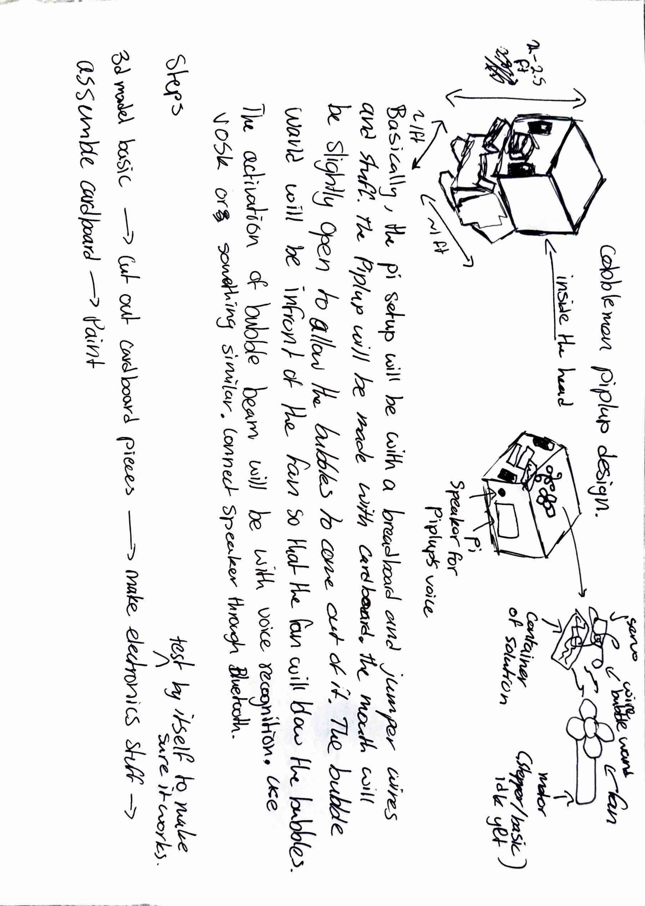
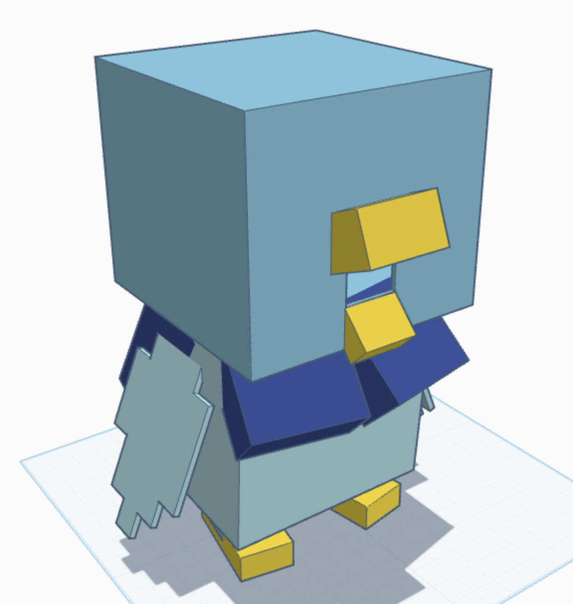

# piplup_2.0
A Piplup that can do Bubble Beam!

## Why I made this project
I've wanted to make something unique for a while that has some type of electronics involved. I also wanted to incorporate an interest of mine into a project which in this case is Pokemon. I got the idea recently to make a series of projects that have to do with making pokemon that can actually perform their moves. I don't have a 3d printer yet which is why I wanted to start off with their Cobblemon designs so I can design them with cardboard!

## 3D models
The 3D models are in the 3dmodels folder. I am not going to actually 3d print with them but I will use them to measure out the amount of cardboard that I need to make the pieces. 

## Materials 
- Cardboard (a lot)
- 15 rpm motor
- A really fast motor (i think i am going to use 150 rpm or faster)
- Wire (to make a bubble wand)
- Some type of plastic food container (to put the bubble solution)
- Fan attachment for the motor (the ones you get in arduino kits)
- Raspberry Pi 4 B 
- USB microphone that can attach to Raspberry Pi 4
- Jumper wires

## Images of Project

Designing the project

3D modeling the project
